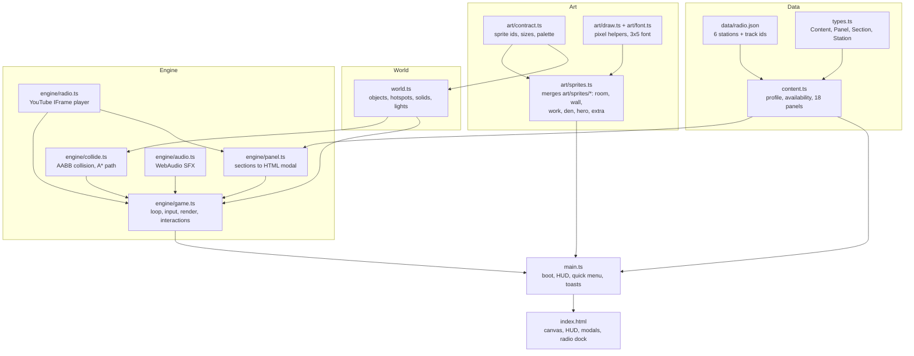
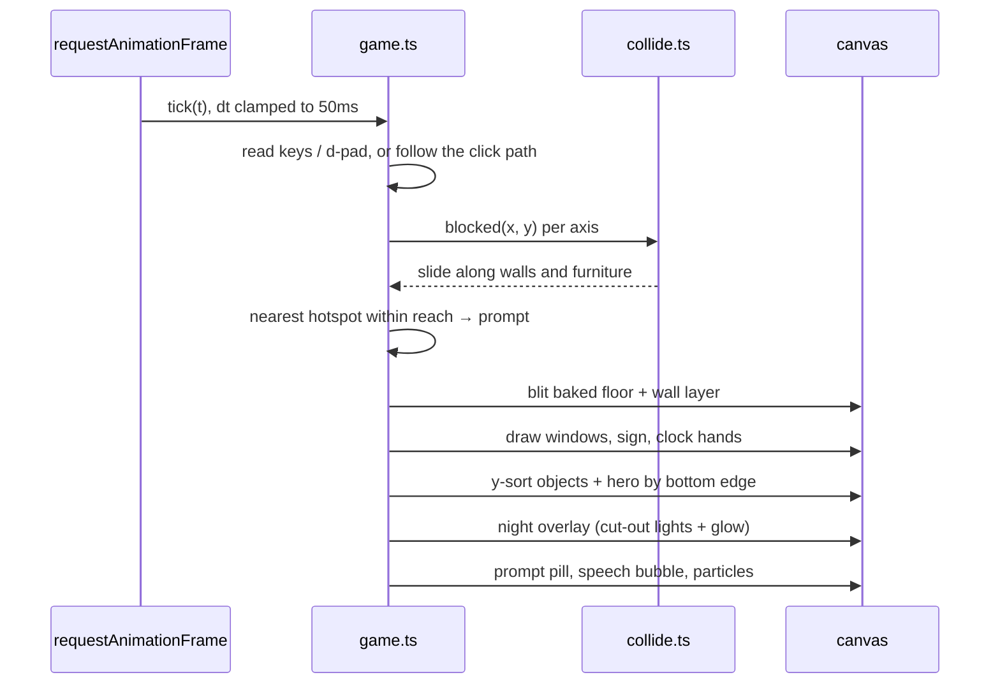
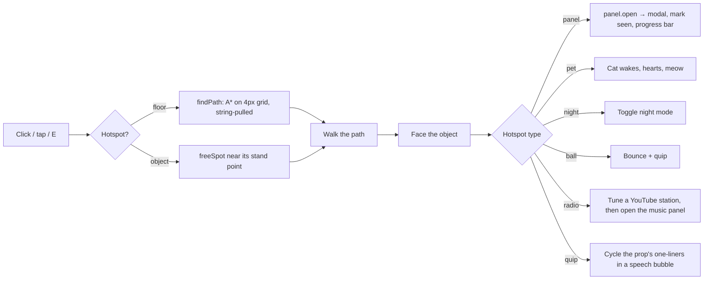

# Ops Room

Priyanshu Kumar Singh's portfolio as a small walkable pixel-art room. You walk a forward deployed engineer around their ops room and den, and every object opens part of the portfolio: the desks are past roles, the arcade cabinets are side projects, the bookshelf is the blog, the radio plays YouTube stations, and the door with the "OPEN TO WORK" sign is how you get in touch.

The classic site is still at [priyanshu14xdevs.in](https://www.priyanshu14xdevs.in).

## Run it

```bash
npm install
npm run dev        # http://localhost:5173
npm run build      # typecheck, then build to dist/
npm run preview    # serve dist/
```

With the dev server running, `/art-preview.html` shows every sprite at 4x and checks its size against the contract.

## Controls

| Input | Action |
|---|---|
| WASD / arrow keys | Walk |
| Shift | Run |
| E / Enter / Space | Use the object you're next to |
| Click or tap the floor | Walk there (A* pathfinding) |
| Click or tap an object | Walk to it and use it |
| N | Toggle night mode |
| Menu → item | Walk to that object (Shift-click opens it directly) |

On touch screens an on-screen d-pad appears.

URL options:

- `?panel=<key>` opens a panel straight away, for example `?panel=proploy`.
- `?night` and `?day` force a lighting mode. Without either, night mode switches on between 18:30 and 06:00 local time.

## Architecture

No framework. One canvas runs the game loop, and plain DOM handles the HUD, the menu, the panels and the radio dock. The only dependencies are TypeScript and Vite.



### One frame



### Using an object



### Rendering

- The world is 400×260 art pixels. The canvas scales it to cover the whole viewport, with image smoothing off and device pixel ratio capped at 2. The scale rounds up to whole device pixels when that crops under 8% more, so art pixels stay even; otherwise it uses the exact cover scale. The camera follows the hero over whatever is cropped and snaps to device pixels.
- Every floor object gets a soft contact shadow, offset away from the top-left light. Shadows are drawn once onto their own layer, so overlaps don't stack, then baked into the floor. Daylight from the den windows falls on the floor and fades out at night.
- The floor, the walls and anything static that hangs on them are baked once to an offscreen canvas. Windows, the door sign and the clock are drawn every frame because they change with the time of day.
- Floor objects and the hero are sorted by their bottom edge, so you can walk behind a desk and in front of it.
- Night mode draws a dark overlay on a second canvas, cuts radial holes in it for each light with `destination-out`, then adds a soft glow pass on top.

### Content

Every panel is data in `src/content.ts`, made of typed sections (`text`, `list`, `tags`, `links`, `stats`, `timeline`, `image`, `video`, `gallery`, `steps`, `posts`, `clock`, `radio`, `status`). `engine/panel.ts` escapes and renders them. To change the portfolio, edit that file. The engine doesn't need to change.

### Radio

The six stations are the YouTube playlists from the classic site. Each station plays its saved track list (`src/data/radio.json`) through the YouTube IFrame API with `loadPlaylist(ids, randomStart)`. YouTube's terms require the player to stay visible at 200×200 or larger, so it sits in a dock while music plays.

### Progress

Visited panels are saved in `localStorage` under `ops-room:seen`. The HUD shows how many you've explored, and confetti goes off when you've seen all 18.

## Project layout

```
index.html            canvas, HUD, menu + panel modals, radio dock
art-preview.html      dev-only sprite sheet
public/               favicon, project screenshots, Proploy launch video
src/
  main.ts             boot, HUD wiring, quick menu, toasts
  content.ts          all portfolio copy
  types.ts            content types
  world.ts            room layout, hotspots, collision boxes, lights
  style.css           cobalt + sunflower theme
  data/radio.json     YouTube stations
  art/                sprite contract, pixel helpers, font, preview
  art/sprites/        code-drawn art, one module per area: room, wall, work, den, hero, extra
  engine/             game loop, collision/pathfinding, panels, radio, audio
```

## Deploy

`vercel.json` sets the Vite framework preset and long-lived cache headers for hashed assets. Import the repo into Vercel, or run `vercel --prod`.
